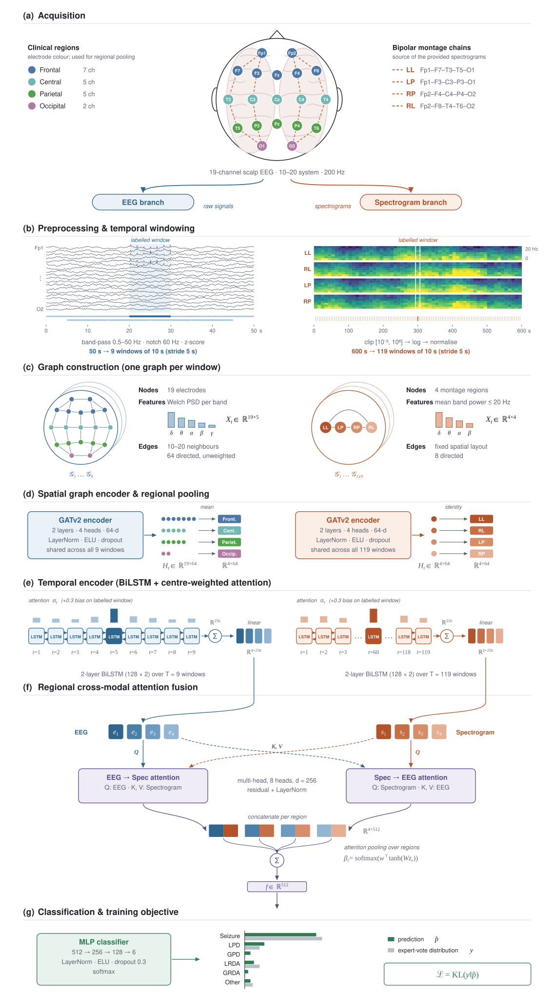

<p align="center">
  
  <br/>
  <sub>Photo by <a href="https://unsplash.com/@theshubhamdhage?utm_source=unsplash&utm_medium=referral&utm_content=creditCopyText">Shubham Dhage</a> on <a href="https://unsplash.com/photos/a-brain-displayed-with-glowing-blue-lines-2sz-3NrmZYU?utm_source=unsplash&utm_medium=referral&utm_content=creditCopyText">Unsplash</a></sub>
</p>

<h1 align="center">AlphaHMS</h1>

<p align="center">
  <b>Multi-modal Graph Neural Networks for Harmful Brain Activity Classification</b>
</p>

<p align="center">
  
  
  
  <a href="LICENSE"></a>
</p>

AlphaHMS classifies harmful brain activity from EEG recordings for the [HMS Harmful Brain Activity Classification](https://www.kaggle.com/competitions/hms-harmful-brain-activity-classification) Kaggle challenge. Each recording is represented as two sequences of graphs — one from the raw 19-channel EEG, one from the montage spectrograms — which are encoded with graph attention networks and BiLSTMs, fused with cross-modal attention, and mapped to six classes: **Seizure**, **LPD**, **GPD**, **LRDA**, **GRDA** and **Other**.

## Overview

- **EEG as graphs.** A 50 s recording becomes 9 overlapping 10 s windows; each window is a graph over the 19 electrodes with band-power node features and 10–20 neighbour edges.
- **Spectrograms as graphs.** The 600 s spectrogram becomes 119 windows, each a 4-node graph over the montage regions (LL, RL, LP, RP).
- **Spatial → regional → temporal.** A shared GATv2 encoder embeds every window, EEG electrodes are pooled into four clinical regions, and a BiLSTM with attention focused on the labelled window summarises each sequence.
- **Cross-modal fusion.** EEG and spectrogram regions attend to each other in both directions before an MLP predicts the expert-vote distribution, trained with KL divergence.
- **Baselines and explainability.** An EEG-only GNN and a raw-EEG MLP are included, together with GNNExplainer and attention-weight analysis.

<p align="center">
  
</p>

<p align="center"><sub><b>Figure 1.</b> The AlphaHMS pipeline, from scalp electrodes to the 6-class prediction.</sub></p>

<!--
## Results

| Model | Config | Validation KL ↓ |
|---|---|---|
| Multi-modal GNN | `configs/train.yaml` | |
| EEG-only GNN | `configs/train_eeg.yaml` | |
| Raw-EEG MLP | `configs/training_mlp.yaml` | |
-->

## Quick start

Requires Python 3.10+, a Kaggle account that has accepted the competition rules, and a [Weights & Biases](https://wandb.ai) account.

```bash
# 1. Install
uv venv --python 3.11 && source .venv/bin/activate
uv pip install -r requirements.txt

# 2. Download the data
mkdir -p data/raw && cd data/raw
kaggle competitions download -c hms-harmful-brain-activity-classification
unzip hms-harmful-brain-activity-classification.zip && cd ../..

# 3. Deduplicate labels (writes data/raw/train_unique.csv) and build the graph dataset
jupyter execute notebooks/eda.ipynb
python src/data/make_graph_dataset.py

# 4. Train
wandb login
python src/train.py --train-config configs/train.yaml
```

## Training

| Model | Command |
|---|---|
| Multi-modal GNN | `python src/train.py --train-config configs/train.yaml` |
| EEG-only GNN | `python src/train.py --train-config configs/train_eeg.yaml` |
| Raw-EEG MLP | `python src/train_mlp.py --config configs/training_mlp.yaml` |
| Smoke test | `python src/train.py --train-config configs/smoke_test.yaml` |

<details>
<summary><b>Cross-validation, resuming and checkpoints</b></summary>

<br/>

- **Folds.** `train.yaml` uses 5 folds and `train_4fold.yaml` uses 4. Each GNN run trains one fold; choose it with `--fold N`. Note that `--fold` writes the new `current_fold` back into the config file.
- **Resuming.** Add `--resume path/to/checkpoint.ckpt`.
- **Checkpoints.** GNN models save to `checkpoints/` and are evaluated on the best checkpoint at the end of training. The MLP runs patient-level K-fold cross-validation (`--n_splits`, default 5) and saves to `artifacts/checkpoints/fold_<k>/`.
- **Logging.** All runs log to Weights & Biases; override the project or run name with `--wandb-project` / `--wandb-name`.

</details>

## Details

<details>
<summary><b>Installation options</b></summary>

<br/>

**pip + venv**

```bash
python3.11 -m venv .venv && source .venv/bin/activate
pip install -r requirements.txt
```

**Conda**

```bash
conda env create -f environment.yaml -y && conda activate graph
pip install torch torchvision torchaudio --index-url https://download.pytorch.org/whl/cu121
pip install torch_geometric
```

The default PyPI `torch` wheel supports CUDA on Linux and MPS on Apple Silicon. To pin a specific CUDA build, install PyTorch from [pytorch.org](https://pytorch.org/get-started/locally/) before the requirements.

</details>

<details>
<summary><b>Data preparation</b></summary>

<br/>

After downloading, `data/raw/` should contain:

```
data/raw/
├── train.csv
├── train_eegs/            # one parquet file per EEG recording
└── train_spectrograms/    # one parquet file per spectrogram
```

`notebooks/eda.ipynb` removes duplicate labels and writes `data/raw/train_unique.csv`, which every later step reads. `make_graph_dataset.py` then writes one `data/processed/patient_{id}.pt` per patient plus a `metadata.pt` index. It accepts `--workers N` and is resumable: patients that already have a file are skipped.

Graph construction, the output format and memory requirements are documented in [src/data/README.md](src/data/README.md).

</details>

<details>
<summary><b>Model configuration</b></summary>

<br/>

Defaults from [configs/model.yaml](configs/model.yaml) and [configs/train.yaml](configs/train.yaml):

| Component | Configuration |
|---|---|
| EEG encoder | GATv2, 2 layers, 4 heads, 64-d → mean pooling into 4 clinical regions → 2-layer BiLSTM (128 × 2) |
| Spectrogram encoder | GATv2, 2 layers, 4 heads, 64-d over 4 montage regions → 2-layer BiLSTM (128 × 2) |
| Temporal readout | attention over windows (+0.3 bias on the labelled window) → 4 regional tokens of 256-d |
| Fusion | bidirectional cross-attention, 8 heads, 256-d → per-region concatenation → attention pooling (512-d) |
| Classifier | MLP 512 → 256 → 128 → 6, LayerNorm, ELU, dropout 0.3 |
| Objective | KL divergence to the expert-vote distribution; optional class weights, graph-Laplacian and edge-weight regularisation |
| Optimisation | AdamW (lr 3e-4, weight decay 1e-4), ReduceLROnPlateau, early stopping, BF16 mixed precision |

The figure is generated by `python assets/make_architecture_figure.py`.

</details>

<details>
<summary><b>Explainability</b></summary>

<br/>

```bash
# GNNExplainer over test samples of a fold (saves to explanations/)
python src/explain.py --model_path checkpoints/last.ckpt \
    --current_fold 0 --num_explain 5

# GNNExplainer on a single patient file (prints results)
python src/explain_model.py --model_path checkpoints/last.ckpt \
    --data_path data/processed/patient_<id>.pt

# Attention-weight heatmaps (saves to explanations/attention/)
python src/explain_attention.py --model_path checkpoints/last.ckpt \
    --data_path data/processed/patient_<id>.pt
```

</details>

<details>
<summary><b>Testing</b></summary>

<br/>

```bash
pytest
```

Model, regularisation and spectrogram-preprocessing tests run anywhere. The data module, pipeline and multiprocessing tests need `data/raw/` and `data/processed/`.

</details>

<details>
<summary><b>Hardware</b></summary>

<br/>

- Developed on H200 and RTX-class GPUs with BF16 mixed precision; `smoke_test.yaml` targets Apple Silicon (MPS).
- Preprocessing is CPU-bound: set `--workers` to your physical core count. Allow ≥ 16 GB RAM.

</details>

<details>
<summary><b>Repository layout</b></summary>

<br/>

```
AlphaHMS/
├── assets/              # Architecture figure and its generator
├── configs/             # Preprocessing, model and training configs (OmegaConf YAML)
├── notebooks/           # EDA and label deduplication
├── src/
│   ├── data/            # Graph construction, datasets and DataModules
│   ├── models/          # Multi-modal GNN, EEG-only GNN, MLP baseline and graph layers
│   ├── lightning_trainer/
│   ├── explainers/
│   ├── train.py         # GNN training entry point
│   ├── train_mlp.py     # MLP training entry point
│   └── explain*.py      # Explainability scripts
├── tests/
├── requirements.txt
└── environment.yaml
```

</details>

## Citation

```bibtex
@software{kgpal2025alphahms,
  author       = {Denis Krylov and Samuel Goldie and Alberto Pasinato and Serkan Akin and Leonardo Lago},
  title        = {{AlphaHMS}: Multi-modal Graph Neural Networks for Harmful Brain Activity Classification},
  year         = {2025},
  institution  = {Delft University of Technology},
  url          = {https://github.com/denskrlv/AlphaHMS},
  note         = {Built for the HMS Harmful Brain Activity Classification challenge (Kaggle)}
}
```

## License

Released under the [MIT License](LICENSE).
